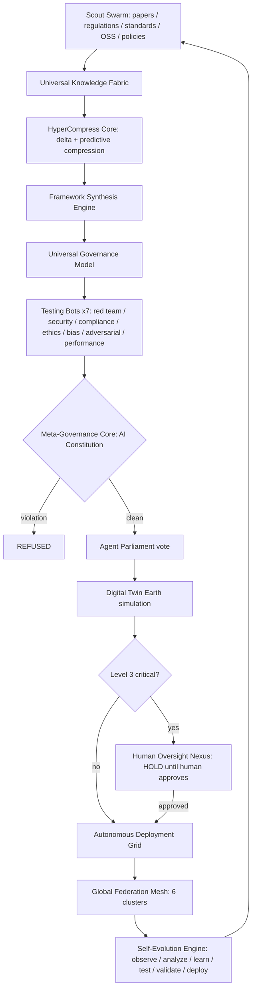
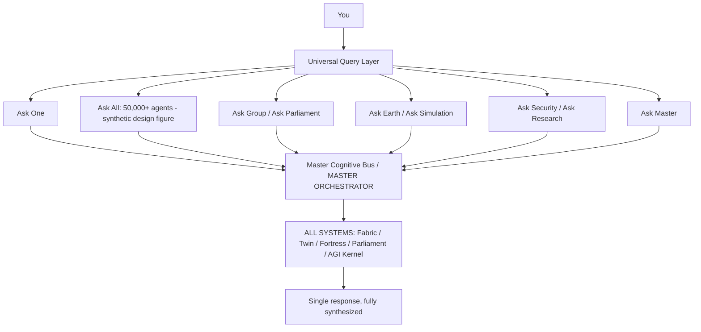
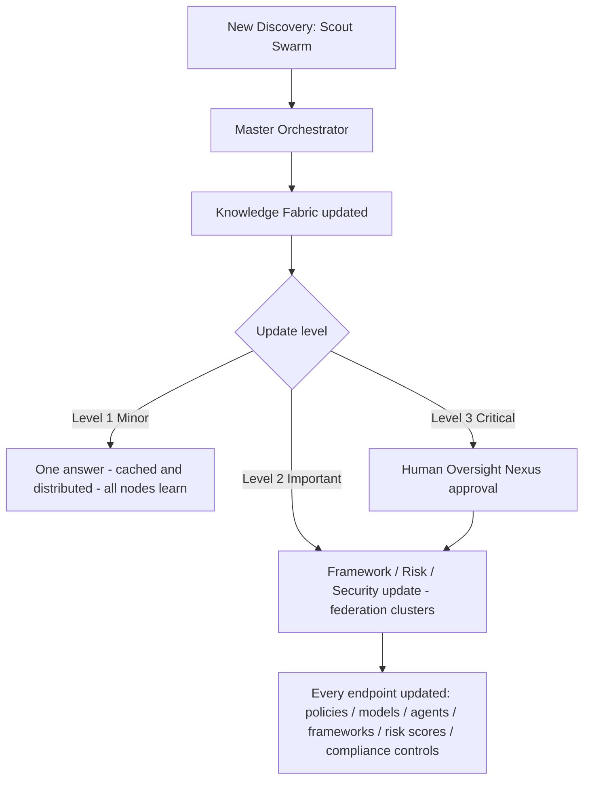
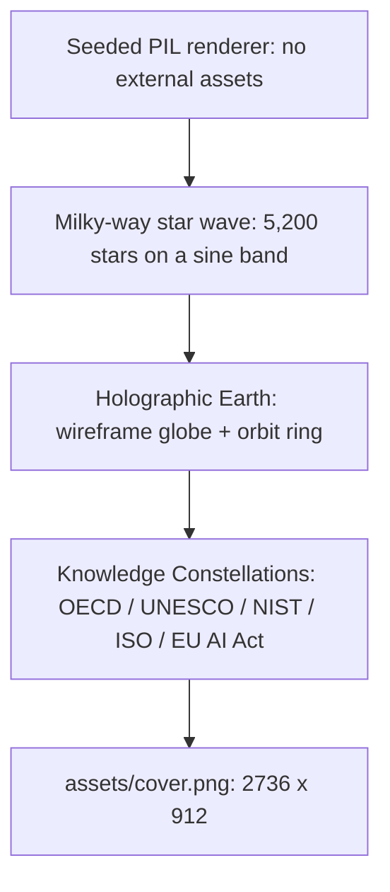

# MilkyWave.SI 🌌

**Planetary Synthetic Intelligence, Governance, Simulation & Holographic Operating System** — by Darion Kellar

MilkyWave.SI is Darion's renamed build of the **HOLOS-CIOS-EARTH ∞** architecture from his screen recording: a **Civilizational Intelligence Operating System (CIOS)** where millions of AI governance agents — in this offline, deterministic model, a governed council of subsystems — continuously **discover, merge, test, simulate and deploy** AI frameworks across a living global AI ecosystem.

> 🌍 *"A cinematic, Iron Man-style holographic control room where AI governance agents continuously discover, merge, test, simulate, and deploy new frameworks across a living global AI ecosystem."* — the vision in the recording

The honest scope, stated everywhere:

- ✅ **What this is:** ONE pure-Python file implementing every named layer of the recording as real, testable code — Knowledge Fabric, Scout Swarm, Synthesis Engine, Testing Bots, Digital Twin Earth, Security Fortress, Identity & Trust Fabric, Economic Engine, Explainability Matrix, Meta-Governance Core + AI Constitution, Agent Parliament, Risk Radar, Memory Archive + Provenance Chain, Holographic Command Center model, Federation Mesh, Update Fabric, Deployment Grid, Self-Evolution Engine, and the Master Orchestrator with **Ask One / Ask All / Ask Group / Ask Parliament / Ask Earth / Ask Simulation / Ask Security / Ask Research / Ask Master**.
- 🚫 **What it is not:** no live scraping of regulators, no real 50,000 agents running, no Google Earth integration, no hologram hardware, and no real government system is touched. The recording's mock-up counters (Papers: 1.2M, Patents: 7M, Repositories: 950k, 50,000+ agents, 99.999% federation sync) are carried in the code **labelled `synthetic_demo_data`** — design figures, not live data.

[](https://github.com/kimanicollier44-cmyk/MilkyWave.SI/actions/workflows/ci.yml)
[](https://github.com/kimanicollier44-cmyk/MilkyWave.SI/actions/workflows/docker-publish.yml)

> ℹ️ These are the **live** workflow badges for this repo. They activate as soon as the `ci.yml` and `docker-publish.yml` files from the paste pack are pasted into `.github/workflows/` — until then they have nothing to report yet.

## 🧰 Tech Stack Badges & Full Architecture Tech Stack

### 💻 Core Programming Languages & Core Systems


- 🐍 **This build:** Python 3.12, pure standard library — zero dependencies, zero network, deterministic (double-run byte-identical demo)
- 🧠 Core systems from the recording: **AGI Kernel, Knowledge Graph Engine, Digital Twin Engine, Simulation Engine, Neural Processing Engine, Master Orchestrator, Master Cognitive Bus**
- 🗣️ Query layer: **Ask One, Ask All, Ask Group, Ask Parliament, Ask Earth, Ask Simulation, Ask Security, Ask Research, Ask Master** — anything entered is routed across the intelligence ecosystem and synthesized into a single coherent answer, while individual subsystems stay queryable

### ⛓️ Web3 & Infrastructure

- 🚫 **No blockchain / token layer — honestly.** The recording's trust layer is cryptographic, not Web3: the **Identity & Trust Fabric** uses SHA-256 agent identities and signatures with zero-trust verification, and the **Knowledge Provenance Chain** hash-chains every archived fact back to its source. No chain, no token, no fake badges.
- 🌐 Infrastructure in the design: **Global Federation Mesh** — Americas / Europe / Asia / Africa / Oceania / Space-Satellite clusters, each keeping its own data sovereign while governance intelligence is shared; **Global Event & Update Fabric** updates every endpoint (Policies, Controls, Models, Frameworks, Agents, Compliance Rules)

### ⚙️ Platform Support & Hardware Architecture


- 🖥️ **This build** runs anywhere Python 3.12+ runs, plus the `python:3.12-slim` Docker image
- 🏛️ Design-target hardware (from the recording, for the full planetary deployment — **not** required to run this build): CPU Clusters, GPU Clusters, TPU Clusters, Neural Processing Engines, Neuromorphic Chips, Simulation Accelerators, FPGA

### ⚡ Low-Level Infrastructure & Performance

- 📉 **HyperCompress Core** — delta storage + predictive compression: concepts are stored once in the fabric dictionary and nodes hold references; the demo prints the **measured** ratio on the real fabric (37 concept references → 26 unique concepts, ratio 1.423), not a marketing number
- ⛓️ Hash-chained Memory Archive (Provenance Chain) — one pass verification, tampering breaks the chain
- 🎯 Deterministic logical ticks instead of wall time, so every run — and every audit — is reproducible

### 🛠️ DevOps & Build Tools


- 🐳 Docker (`python:3.12-slim`), GitHub Actions CI + Docker Publish (delivered in the paste pack)
- 🎯 Target image: `credkellar/milkywave-si:latest`
- 🧪 Tests: `pytest` (19 tests) + the built-in CHECKS suite (48 checks) in `main.py`

### ☁️ Cloud Providers

- 🚫 **None required — honestly.** The design federates across global cloud / supercomputer / satellite clusters; this build runs fully offline on your own machine or in a local Docker container. Docker Hub appears only as the registry the publish workflow pushes the image to.

## What is this?

**1. International AI Frameworks and Governance Structures** — the library the whole system is built on:

| Framework / Organization | Type | Purpose |
|---|---|---|
| OECD AI Principles | International policy framework | Promotes trustworthy, transparent, human-centered AI |
| UNESCO Recommendation on the Ethics of AI | Global ethical framework | Adopted by UNESCO member states for responsible AI development and use |
| EU AI Act | Law / regulation | Risk-based legal framework for AI systems |
| NIST AI Risk Management Framework | Risk management framework | Widely used globally for AI risk |
| ISO/IEC 42001 | Management system standard | AI Management Systems |
| ISO/IEC 23894 | Risk management standard | AI Risk Management |
| IEEE 7000 Series | Technical standards | Ethical design for autonomous systems |
| Bletchley Declaration | International declaration | Frontier AI safety |
| Council of Europe Framework Convention on AI | Treaty | First legally binding international AI treaty |
| AI Verify (Singapore) | Assurance framework | AI assurance and testing |

**National AI Strategies** tracked in the design: United States, Canada, United Kingdom, France, Germany, Italy — and a master list of 80+ countries is the recording's stated next expansion.

**AI Governance Structure Layers:** 1. Laws and Regulations · 2. Ethical Principles · 3. Risk Management Frameworks · 4. Management Systems · 5. Technical Standards · 6. Audit and Assurance Frameworks · 7. Sector-Specific AI Governance (healthcare, finance, defense, education)

**Governance principles taxonomy:** Ethics (Fairness, Non-discrimination, Human rights) · Transparency (Explainability, Disclosure of AI use) · Privacy & Data Protection (Data governance, Security controls) · Risk Management (Risk assessment, Impact evaluation) · Safety & Security (Reliability, Cybersecurity) · Human Oversight · Accountability · Compliance · Sustainability · Continuous Learning

## What this does — step by step

1. 🌌 **Foundation — Universal Knowledge Fabric.** Contains AI Frameworks, Laws, Regulations, Standards, Research Concepts and Patents. Everything the system knows enters here.
2. 📥 **Step 2 — Knowledge ingestion.** Documents, Videos, APIs, Databases and Papers become **Knowledge Nodes**; exact duplicates collapse (deduplication) and shared concepts fuse (semantic fusion).
3. 🛰️ **Layer 2 — Scout Bots.** Autonomous agents continuously monitor research papers, regulatory updates, standards organizations, open-source projects and government policies. Outputs: new framework proposals and risk alerts, with heat patterns for emerging AI threats, regulatory changes, compliance failures and security incidents.
4. 🧪 **Layer 4 — Testing Bots.** Before adoption, every framework revision must pass automated testing by **Red Team, Security, Compliance, Ethics, Bias Detection, Adversarial Attack and Performance Bots** — all seven, or it does not move.
5. 🔀 **Framework Synthesis Engine.** Merges OECD, UNESCO, EU, NIST, ISO, IEEE and national systems via Deduplication, Semantic Fusion, Concept Extraction, Delta Storage and Predictive Compression into a **Universal Governance Model**; the Synthetic Reasoning Engine adds Detection + Prediction and flags governance gaps.
6. 🌍 **Step 8 — Digital Twin Earth simulation.** A full planetary simulation (Planet Core + Climate, Economic, Infrastructure and Governance layers) runs scenarios — new AI laws, cyber incidents, economic shocks, technology breakthroughs, climate impacts, pandemic responses, infrastructure upgrades — **without affecting the real world. Changes are tested before deployment.**
7. 🛡️ **Security Fortress + Adversarial Defense Grid.** Continuous attack simulation (Red / Blue / Purple Team; Model, Data, Network and Agent Security) plus detection of prompt attacks, model tampering, fake regulations, poisoned data and supply-chain implants — hits are **QUARANTINED**, never adopted.
8. 🪪 **Identity & Trust Fabric + AI Constitution.** Digital and agent identities with cryptographic signatures and zero-trust verification on every proposal; above everything, the **Meta-Governance Core** governs the governing system and holds the immutable **AI Constitution: Human Rights, Human Oversight, Transparency, Safety** — no agent can override it.
9. 🚀 **Step 9 — Autonomous deployment.** The Deployment Grid updates Policies, Models, Agents, Frameworks, Controls and Compliance Rules — only for revisions that passed every Testing Bot, satisfy the Constitution, carried the **Agent Parliament**, and, if critical (Level 3), cleared the **Human Oversight Nexus**: human leaders retain ultimate authority over critical decisions. That gate never auto-opens.
10. 🖐️ **Step 10 — Holographic visualization.** The Holographic Command Center presents Earth, the Knowledge Galaxy, Framework Constellations (OECD, UNESCO, NIST, ISO and the EU AI Act as orbiting knowledge satellites linked to countries and industries), Risk Clouds and Agent Swarms — with the recording's gesture controls: **Pinch = Zoom, Swipe = Navigate, Rotate = Rotate Earth, Fist = Lock System, Palm = Global Overview, Two Fingers = Deploy Framework** — and a Self-Evolution loop (Observe → Analyze → Learn → Test → Validate → Deploy → Observe) that stops dead at a failed test.

## 🗺️ How it works — diagram per script

### `main.py` — the whole system



### `main.py` § Master Orchestrator — Ask modes



### `main.py` § Update workflow — from discovery to every endpoint



### `make_cover.py` — the cover pic



## 🌟 10 reasons this is cool

1. It takes the recording's full 20-layer vision — including all 13 "missing layers" and the 20 highest-impact additions — and makes every single one of them runnable code, not slides.
2. A framework update has to survive scouts, a signature check, an adversarial scan, 7 testing bots, an immutable constitution, a parliament vote and a planetary simulation before it deploys — governance with actual gates.
3. The one gate that matters most — critical deployment — is held by a human, forever, by design.
4. Digital Twin Earth lets you break the planet safely: pass a bad AI law in simulation, watch the risk delta, never touch the real one.
5. Ask All turns "how can humanity govern superintelligence safely?" into a consensus report from seven specialist councils in one call.
6. Every decision carries Who / What / When / Why / Impact / Evidence — the Explainability Matrix means there is no anonymous decision anywhere in the system.
7. The Memory Archive's provenance chain means every fact can be walked back to its original source, and tampering with history breaks the chain in the open.
8. Framework Constellations make governance visible: treaties and standards as satellites orbiting a holographic Earth, linked to the countries they govern.
9. HyperCompress reports its real measured ratio on the real fabric — the system is honest about its own numbers, including labelling its synthetic demo counters.
10. It is one file, zero dependencies, byte-identical on every run — a planetary operating system you can read end to end in one sitting.

## 🧩 10 problems this solves

1. **Regulatory complexity** — dozens of overlapping frameworks merged into one Universal Governance Model with shared concepts extracted.
2. **Information fragmentation** — papers, laws, standards, patents and incidents land in one Knowledge Fabric instead of scattered silos.
3. **Duplicate knowledge** — deduplication + semantic fusion collapse repeated frameworks and concepts to single nodes.
4. **Slow decision making** — the Master Orchestrator routes any question to the right subsystem (or all of them) and synthesizes one answer.
5. **AI safety governance** — an immutable AI Constitution plus 7 testing bots stand between any proposal and deployment.
6. **Global coordination** — the Federation Mesh propagates governed updates to six regional clusters at three classified levels.
7. **Research discovery** — the Scout Swarm watches papers, patents, standards and policies continuously, so new frameworks surface as proposals, not surprises.
8. **Holographic visualization** — risk, frameworks and agent swarms become one spatial picture (Earth + constellations + risk clouds) instead of a thousand dashboards.
9. **Unaccountable automation** — Explainability Matrix + hash-chained audit memory make every automated decision attributable and replayable.
10. **Unsafe self-improvement** — the Self-Evolution Engine improves the system only through the same test/validate gates, and stops at the first failed test.

## 🚀 Installation

**Step 1 — Clone**

```shell
git clone https://github.com/kimanicollier44-cmyk/MilkyWave.SI.git
cd MilkyWave.SI
```

**Step 2 — Environment (optional, names only)**

```shell
cp .env.example .env
```

**Step 3 — Run**

```shell
python3 main.py demo
python3 main.py checks
python3 main.py frameworks
python3 main.py ask security "Find vulnerabilities."
```

**Step 4 — Start infrastructure (Docker)**

```shell
docker compose up -d
```

**Step 5 — Deploy Kubernetes (design target, for the full planetary deployment)**

```shell
kubectl apply -f infrastructure/
```

**Step 6 — Build services (design-target polyglot build, from the recording)**

```shell
cargo build --release
npm install
pip install -r requirements.txt
```

## 📋 Requirements

**To run this build:** Python 3.12+ — nothing else. No dependencies, no network, no keys.

**Recommended (recording, for a serious node):** 128 CPU cores · 1TB RAM · 100TB NVMe · 64× H100 GPUs · multi-node cluster · 100Gb networking

**Enterprise (recording, planetary scale):** Supercomputer Cluster · Quantum Integration Ready · Satellite Connectivity · Global Cloud Federation

## 🌳 Full Project Structure Tree

```text
MilkyWave.SI/
├── main.py                  # The whole system: fabric, scouts, synthesis, testing bots,
│                            # twin Earth, fortress, trust, economics, explainability,
│                            # constitution, parliament, radar, archive, holography,
│                            # federation, updates, deployment, evolution, orchestrator
├── make_cover.py            # Seeded PIL cover generator (2736x912)
├── tests/
│   └── test_main.py         # 19 pytest tests
├── conftest.py              # Puts the repo root on sys.path for pytest
├── assets/
│   └── cover.png            # Cover pic (uploaded separately - binary)
├── Dockerfile               # python:3.12-slim, runs the demo
├── docker-compose.yml       # One-service compose: credkellar/milkywave-si:latest
├── requirements.txt         # Stdlib only for main.py; pytest for tests
├── .env.example             # Names only - the system needs zero secrets
└── README.md
```

**Supreme Architecture (from the recording):**

```text
HOLOS-CIOS-EARTH ∞
└── MilkyWave.SI
    ├── Master Orchestrator
    │   ├── Ask One / Ask All / Ask Group / Ask Parliament
    │   ├── Ask Earth / Ask Simulation / Ask Security / Ask Research
    │   └── Ask Master
    ├── Universal Knowledge Fabric + HyperCompress Core
    ├── Scout Swarm + Framework Synthesis Engine
    ├── Digital Twin Earth + Synthetic Reasoning Engine
    ├── Security Fortress + Adversarial Defense Grid
    ├── Identity & Trust Fabric + Meta-Governance Core (AI Constitution)
    ├── Agent Parliament + Human Oversight Nexus
    ├── Economic Engine + Explainability Matrix
    ├── Long-Term Memory Archive + Provenance Chain
    ├── Holographic Spatial Interface + Executive AI Avatar
    ├── Global Federation Mesh + Autonomous Deployment Grid
    ├── AGI Kernel
    └── Self-Evolution Engine
```

## 👤 Author

**Darion Kellar** — network developer / engineer, open-source builder. MilkyWave.SI is the renamed HOLOS-CIOS-EARTH design from his Copilot session recording (2026-11-24): Synthetic Intelligence frameworks, governance layers, scout/testing bots, the 13 missing layers, the 20 highest-impact additions, Digital Twin Earth, knowledge constellations, and the supreme Ask architecture — built, verified (pytest 19, CHECKS 48/48, demo exit 0), and pushed as one deterministic Python file.
